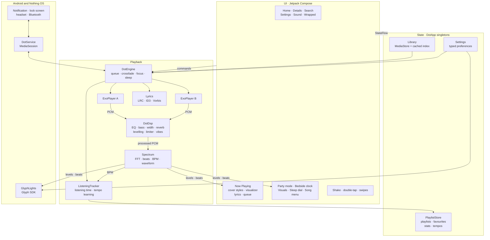
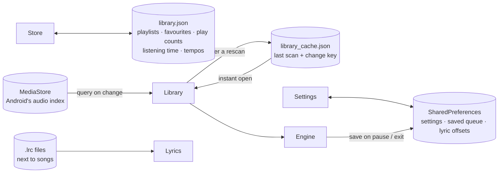
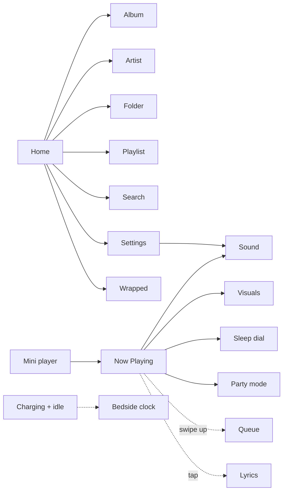
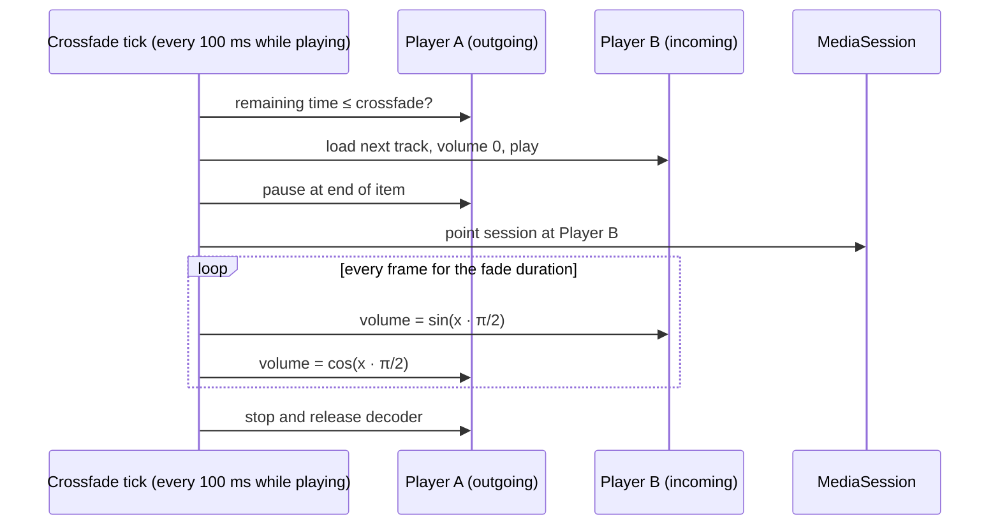
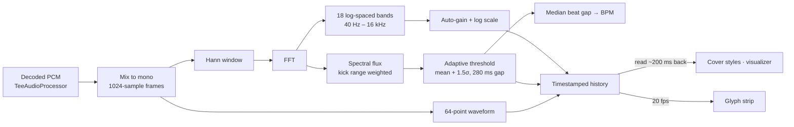
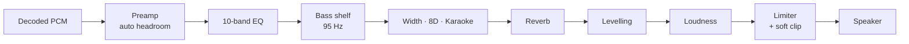

# Dot

[](https://github.com/dhananjay6561/dot/actions/workflows/build.yml)
[](https://github.com/dhananjay6561/dot/releases/latest)
[](LICENSE)


An offline music player for Android, designed around the Nothing OS look: pure black, dot-matrix type, a single red accent. Built for the Nothing Phone (4a), and it runs on any phone with Android 10 or newer. On Nothing phones it also drives the Glyph lights on the back.

Dot plays the music that lives on your phone. No accounts, no streaming, no ads, no network calls.

| | Size |
| --- | --- |
| Download | **1.8 MB** |
| Installed | **3.6 MB** |

For comparison, most streaming music apps install at well over 100 MB.

## Download

Grab **`Dot-1.0.0.apk`** from the [latest release](https://github.com/dhananjay6561/dot/releases/latest), open it on your phone and allow installing from that source. Android 10 or newer.

<p align="center">
  
  
  
  
</p>

## Features

**Playback**
- Crossfade between tracks on an equal-power curve, adjustable from off to 12 seconds
- Short blend when skipping, soft fade on play and pause
- Gapless playback when crossfade is off
- Shuffle, repeat all, repeat one, playback speed from 0.5x to 2x
- Queue editing: play next, add to queue, reorder, remove
- Picks up where you left off: queue, track and position survive restarts
- Swiping Dot away from recents stops the music

**Sleep timer**
- Analog dial: drag the knob around the face, one turn per hour, up to three hours
- Each hour fills its own ring of dots, with the stop time shown in the middle
- Quick presets, "end of this song", and a gentle fade out before stopping

**Sound** (Dot's own audio engine, the same on every phone)
- One-tap sound modes: Hi-Fi, Bass Boost, Super Bass, Panoramic, Concert, Vocal, Club, Cinema
- 10-band equalizer from 31 Hz to 16 kHz (±12 dB) with nine presets and per-band dot sliders
- A true low-shelf bass boost, mid/side stereo widening (Panoramic) and room reverb (Room, Studio, Hall, Arena, Plate)
- Automatic headroom and a peak limiter, so boosted settings never clip or crackle
- Volume levelling, so quiet and loud tracks play at a similar level
- **Vibes:** Slowed + Reverb, Nightcore, 8D (the song circles your head) and Karaoke (vocal remover)
- Lossless formats: FLAC, ALAC, WAV, plus Opus, Vorbis, MP3 and AAC

**Visuals**
- Three cover styles, switched by tapping the art:
  - **Cover:** the album art; wide or tall covers are shown in full over a blurred fill
  - **Dot art:** the cover redrawn as a colour halftone that swells and ripples on every beat
  - **Halo:** a round cover with dot spokes following the spectrum and red rings rippling out on beats
  - **Vinyl:** a spinning record at 33⅓ RPM with dotted grooves and a tonearm that tracks progress; grab it to scratch through the song
- Three visualizer styles, switched by tapping the strip: **Grid**, **Mirror** and **Wave**
- Real-time beat detection with a live BPM readout
- A Visuals panel with live previews of every style, rendered from the song that's playing
- **Party mode:** a full-screen landscape dot field with beat rings and the song in big dot type, screen kept on
- **Bedside clock:** a big dot-matrix clock with what's playing; opens by itself on the charger after a minute untouched, dims, and shifts slightly so the OLED never burns in

**Glyph lights** (Nothing Phone (4a))
- The rear light strip reacts to the music:
  - **Meter:** the six LEDs climb with the bass, with smooth per-LED brightness
  - **Pulse:** the whole strip flashes on every beat
  - **Progress:** the strip fills as the song plays
- Brightness, sensitivity and beat-flash controls, with a live on-screen mirror of the strip
- Controlled from the Glyph button on Now Playing or from Settings

**Lyrics**
- Synced `.lrc` files and lyrics embedded in ID3 or Vorbis tags
- Karaoke fill: the current line lights up left to right as it's sung, including wrapped lines
- The current line stays in focus with smooth scrolling and fading neighbours
- Breathing dots during instrumental breaks
- Tap any line to jump there; scroll freely and it re-syncs on its own
- Per-song timing offset for files that run early or late
- Finds `.lrc` files even when their names don't match the song file exactly

**Library**
- Songs, albums, artists, folders and playlists
- Favourites, Recently added and Most played lists
- Mood mixes: Dot learns each song's tempo on its first play and sorts it into **Chill**, **Groove** or **Hype**
- Search across songs, albums and artists
- Fast scroller with a letter bubble on long lists
- Cleans download-site junk from tags for display, such as "(DjPunjab.CoM)", "- PagalNew" or "320 Kbps"; files are never modified
- Hides WhatsApp voice notes and clips below a minimum length
- Opens instantly from a cached index and only rescans when Android reports a change

**Dot Wrapped**
- Total listening time, top artists, top songs and a day streak
- A listening clock showing when in the day you listen, and the last seven days
- A listener type (Early bird, Daydreamer, Evening soul, Night owl)
- A summary card you can share as an image

**Gestures**
- Double-tap the art to like, with a heart burst
- Swipe the art sideways for next or previous, swipe up for the queue, swipe down to close
- Shake twice for a random song

**Feel**
- Nothing-style dot-matrix sliders that grow under your finger, with value bubbles and haptic ticks
- Buttons and pills squish on press, icons scale and cross-fade when they change, colours fade between states
- Liking a song pops the heart
- Two-pane Now Playing in landscape; sheets open fully and scroll on short screens

**System**
- Keeps playing in the background and with the screen locked
- Lock-screen and notification controls with album art
- Headset and Bluetooth buttons, pauses for calls, ducks for navigation, pauses when headphones disconnect

## Screenshots

### Library

<table>
<tr><td align="center"><br><sub>Songs</sub></td><td align="center"><br><sub>Albums</sub></td><td align="center"><br><sub>Playlists and mood mixes</sub></td></tr>
</table>

### Cover styles

<table>
<tr><td align="center"><br><sub>Cover</sub></td><td align="center"><br><sub>Dot art</sub></td><td align="center"><br><sub>Halo</sub></td><td align="center"><br><sub>Vinyl</sub></td></tr>
</table>

### Visualizers and Glyph

<table>
<tr><td align="center"><br><sub>Mirror visualizer</sub></td><td align="center"><br><sub>Wave visualizer</sub></td><td align="center"><br><sub>Visuals and Glyph panel</sub></td></tr>
</table>

### Sound

<table>
<tr><td align="center"><br><sub>Sound modes</sub></td><td align="center"><br><sub>Equalizer and enhancements</sub></td></tr>
</table>

### Player tools

<table>
<tr><td align="center"><br><sub>Queue</sub></td><td align="center"><br><sub>Analog sleep timer</sub></td><td align="center"><br><sub>Search</sub></td></tr>
</table>

### Dot Wrapped and settings

<table>
<tr><td align="center"><br><sub>Wrapped summary</sub></td><td align="center"><br><sub>Top songs and listening clock</sub></td><td align="center"><br><sub>Settings</sub></td></tr>
</table>

### Party mode and bedside clock

<table>
<tr><td align="center"><br><sub>Party mode</sub></td>
<td align="center"><br><sub>Bedside clock</sub></td></tr>
</table>

## Architecture

Dot is a single-module app in four layers. Data flows up as `StateFlow`; commands flow down as plain method calls on a few app-wide singletons created in `DotApp`.



- **The UI never touches ExoPlayer.** Screens read `StateFlow`s and call methods on `DotEngine`, which owns both players.
- **One code path for every control.** `DotService` wraps the engine in a Media3 `MediaSession`, so the notification, lock screen and headset buttons drive exactly the same methods as the app's buttons.
- **The analyser is shared and reference-counted.** Visuals, the Glyph strip and tempo learning each acquire `Spectrum` while they need it. It does no work when nobody holds it, and skips the waveform when only the strip and tempo learning listen.
- **Overlays are plain composables.** Party mode, the bedside clock and the sheets sit on top of the navigation stack in `Root`, so they keep their own state and close with back.

### Data and persistence

Dot has no database. Everything persists in three small files and Android's own media index:



- **Opening the app:** the library loads from `library_cache.json` straight away, then Dot compares MediaStore's change counter and filters with the cached key and only re-queries if something changed.
- **While playing:** listening time is written at most once a minute; a song's tempo is written once, after its first play.
- **Writes are debounced and atomic:** `library.json` is written to a temporary file and renamed, so a crash mid-write can't corrupt it.

### Screens and overlays



## How crossfade works

A single ExoPlayer can't play two tracks at once, so Dot runs two. The active player holds the whole queue, which keeps gapless playback and notification controls working natively. When a fade begins, the spare player loads the next track and the roles swap.



- **Equal-power curve.** Sine in, cosine out keeps perceived loudness constant through the blend, where a linear fade dips in the middle.
- **Waits for the decoder.** The fade clock only starts once the incoming track is ready, so the first beat isn't lost.
- **Interruptible.** Skipping mid-fade cuts the old outgoing track and fades out from whatever volume the current one has reached.
- **One audio focus owner.** The engine requests focus itself. Two players requesting it separately would pause each other.
- **One audio session.** Both players share a session ID, so the equalizer applies to both sides of a fade.

## How the visualizer, beats and Glyph lights work

Most Android visualizers need microphone permission. Dot taps the decoded audio straight out of ExoPlayer instead, so it needs no extra permission and only hears the music.



- **Levels.** Each 23 ms frame becomes 18 frequency bands, normalised against a slowly decaying peak so quiet and loud tracks both fill the grid.
- **Beats.** Spectral flux measures how much energy *rose* since the previous frame, mostly in the 30 to 180 Hz kick range. A beat fires when that rise clears the recent average by a margin, with a refractory gap so one hit can't fire twice. The median gap between beats gives the BPM.
- **Sync.** Audio is decoded ahead of the speaker by the output buffer. Every frame is timestamped and readers take the one that is audible now, not the one just decoded.
- **Glyph strip.** The low bands drive a six-LED meter with per-LED brightness, beats flash the whole strip, and frames are only sent over the binder when they visibly change.

## How the sound engine works

Android's built-in effects differ from phone to phone, so Dot processes audio itself, inside each player, before it reaches the speaker:



- **Headroom first.** The preamp pulls the signal down by most of the biggest boost, so the EQ and bass shelf can't overload. The limiter catches whatever is left, and a soft clip rounds off any final peak instead of crackling.
- **Filters** are standard RBJ biquads; bands set to 0 dB are skipped entirely.
- **Panoramic** widens the side signal; **8D** pans the centre slowly around your head; **Karaoke** keeps the sides and only the low end of the centre, where most vocals sit.
- **Slowed + Reverb** and **Nightcore** change speed and pitch together, like a record at the wrong speed, with a big room added for Slowed.
- Both crossfading players run their own copy of the chain from shared settings, so effects carry straight through a blend.

## Performance

Dot is built to stay light on battery and memory:

- The engine tick runs only while music plays and sleeps completely when paused.
- Visuals render at most 60 fps, even on 120 Hz screens, and stop once the music is paused and the dots have settled.
- Dot art paints its halftone once into a bitmap; each frame only scales it and lights the ripple band.
- The analyser runs only while a visual or the Glyph strip is using it; the waveform is skipped when only the strip listens.
- Analyser buffers are reused instead of reallocated on every frame.
- Listening stats are written once a minute and on pause, not continuously.
- The library opens from a cached index and only rescans when MediaStore's change counter moves.
- Album art comes from `ContentResolver.loadThumbnail` with an in-memory LRU cache, with no image library.
- Only the parts that change every frame update: the seek bar, the lyric fill and the beat dot repaint without rebuilding the screen.
- The current lyric line is found by binary search; queue edits change the list in place instead of rebuilding it.
- Analyser frame lookups walk back from the newest frame and beat statistics are kept as running sums.
- Search is debounced and matched off the main thread.
- Album art is cached in three size buckets; vinyl grooves are a one-byte alpha mask.
- Tempo is learned once per song from its first 25 seconds, then never measured again.
- Release builds are shrunk and optimised with R8: a 1.8 MB download and 3.6 MB installed.
- Only English resources, arm64 native code and the audio extractors a music library needs are packaged.
- Fonts are subset to Latin, and the Doto variable font is frozen to the one style Dot uses.

## Tech stack

| Area | Choice |
| --- | --- |
| Language | Kotlin |
| UI | Jetpack Compose, Material 3 (restyled) |
| Playback | AndroidX Media3 ExoPlayer and MediaSession |
| Audio processing | Dot's own DSP chain inside ExoPlayer: RBJ biquad EQ and shelf, mid/side width, Freeverb-style reverb, RMS levelling, peak limiter |
| Glyph | Nothing Glyph Developer Kit |
| Library | MediaStore with a content observer and a cached index |
| Storage | SharedPreferences and JSON files, no database |
| Fonts | Doto (dot matrix) and Space Mono |

## Project structure

```
app/src/main/java/com/dj/dot
├── DotApp.kt              app singletons
├── MainActivity.kt        edge-to-edge host, binds the media controller
├── data/
│   ├── Models.kt          Song, Album, Artist, Folder, Playlist
│   ├── Library.kt         MediaStore scan, cache and auto-rescan
│   ├── TagCleaner.kt      strips download-site junk from tags
│   ├── PlaylistStore.kt   playlists, favourites, play counts, listening stats
│   └── Settings.kt        typed preferences as StateFlows
├── playback/
│   ├── DotEngine.kt       dual-player engine, crossfade, focus, queue
│   ├── ListeningTracker.kt listening time and tempo learning
│   ├── DotService.kt      media session service and notification art
│   ├── DotDsp.kt          the audio chain: EQ, bass, width, 8D, karaoke, reverb, levelling, limiter
│   ├── AudioFx.kt         maps sound settings, presets and modes onto the chain
│   ├── Spectrum.kt        FFT, bands, beats, BPM, waveform
│   ├── GlyphLights.kt     rear light strip modes
│   └── Lyrics.kt          LRC, ID3 USLT and Vorbis lyrics, lrc matching
└── ui/
    ├── Theme.kt           colours and type
    ├── Components.kt      pills, sliders, art, fast scroller, press animations
    ├── DotIcons.kt        the dot-matrix Visuals icon
    ├── Root.kt            navigation, permissions, mini player
    ├── Home.kt            library tabs
    ├── Details.kt         album, artist, folder, playlist
    ├── NowPlaying.kt      player, queue, sleep sheet
    ├── Visualizers.kt     grid, mirror, wave, dot art, halo
    ├── VisualsSheet.kt    visuals and Glyph panel with live previews
    ├── VinylViz.kt        spinning record with scratch to seek
    ├── PartyMode.kt       full-screen landscape visualizer
    ├── BedsideMode.kt     night-stand clock
    ├── ShakeToShuffle.kt  shake gesture
    ├── LyricsView.kt      karaoke lyrics
    ├── SleepDial.kt       analog sleep timer
    ├── WrappedScreen.kt   listening stats
    ├── SearchScreen.kt
    ├── SettingsScreen.kt  settings and the sound screen
    └── Sheets.kt          song menu, playlist picker, dialogs
```

## Building

Requirements: JDK 17 or newer and the Android SDK (platform 36).

```bash
git clone https://github.com/dhananjay6561/dot.git
cd dot
echo "sdk.dir=/path/to/android/sdk" > local.properties
./gradlew assembleRelease
```

The APK lands in `app/build/outputs/apk/release/`. The first build downloads the Nothing Glyph SDK from its [official repository](https://github.com/Nothing-Developer-Programme/Glyph-Developer-Kit) into `app/libs/`, since it isn't published to Maven.

## Installing on a phone

1. Enable Developer options: **Settings → About phone → tap Build number 7 times**.
2. Turn on **USB debugging** or **Wireless debugging** in Developer options and connect the phone.
3. Run:

```bash
./gradlew installRelease
```

Or copy the APK to the phone and open it, allowing installs from that source when asked.

### Recommended on first launch

- Allow music access when prompted.
- **Settings → Keep playing in background** exempts Dot from battery optimisation, so the system never stops playback.
- **Settings → Lyrics file access** is only needed if you keep `.lrc` files next to your songs.
- On a Nothing Phone (4a), open the Glyph button on Now Playing and pick a light mode.

## Permissions

| Permission | Why |
| --- | --- |
| `READ_MEDIA_AUDIO` | Read your music |
| `POST_NOTIFICATIONS` | Playback notification |
| `FOREGROUND_SERVICE_MEDIA_PLAYBACK` | Keep playing in the background |
| `WAKE_LOCK` | Don't stall with the screen off |
| `com.nothing.ketchum.permission.ENABLE` | Drive the Glyph lights on Nothing phones |
| `REQUEST_IGNORE_BATTERY_OPTIMIZATIONS` | Optional, asked from Settings |
| `MANAGE_EXTERNAL_STORAGE` | Optional, only for `.lrc` files |

Dot has no internet permission.

## Roadmap

- Beat-matched crossfade
- Home-screen widget and Quick Settings tile
- Format badge (codec, bit depth, sample rate)
- Backup and restore of playlists and stats

## Contributing

Bug reports, ideas and pull requests are welcome. Read the [contributing guide](CONTRIBUTING.md) first; this project follows the [Contributor Covenant](CODE_OF_CONDUCT.md). Security problems go through the [security policy](SECURITY.md), not public issues.

## Credits

- [Doto](https://fonts.google.com/specimen/Doto) and [Space Mono](https://fonts.google.com/specimen/Space+Mono), both under the SIL Open Font License
- [AndroidX Media3](https://github.com/androidx/media)
- [Nothing Glyph Developer Kit](https://github.com/Nothing-Developer-Programme/Glyph-Developer-Kit)
- Library and queue ideas inspired by open-source players such as Auxio

## License

Dot is licensed under the [Apache License 2.0](LICENSE). Bundled fonts are under the SIL Open Font License; see [NOTICE](NOTICE) for third-party attributions.
